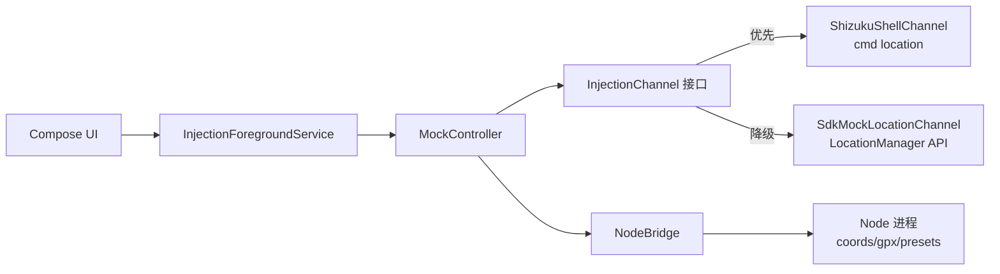
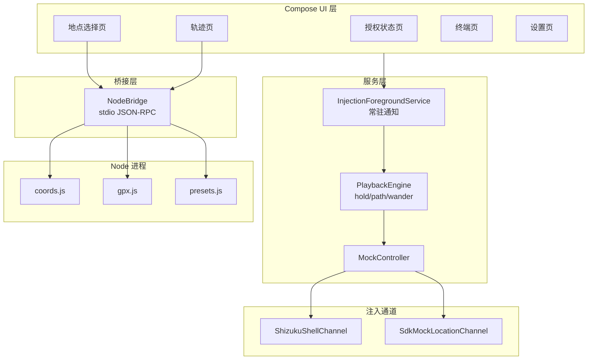

## 产品概述

把现有的 locctl 虚拟定位工具打包成一个**完全独立运行的 Android APK**，装到手机上后不再需要电脑、不需要 USB 线、不需要 root 也能使用。用户在 App 内完成授权、选点、注入、轨迹播放和脚本调试的全部操作。

## 核心功能

### 授权与权限管理
- 启动后自动检测当前可用的注入通道并显示状态
- 支持两条注入通道自动降级：有 shell 权限时走 `cmd location` 命令通道；否则回退到系统 SDK 模拟定位通道
- 引导用户完成一次性授权（开发者选项选模拟位置应用 / Shizuku 授权），并实时显示是否生效
- 一键自检：定位总开关、模拟定位权限、厂商网络定位干扰项

### 地点选择与注入
- 内置 48 个地点（国内城市地标 + 境外），支持名称、别名、分类模糊搜索
- 支持手动输入任意坐标，可指定坐标系（全球定位坐标 / 高德坐标 / 百度坐标）
- 注入前自动把坐标统一换算为设备底层坐标，并同时展示两套坐标值便于核对
- 一键注入并保持，或恢复真实定位

### 常驻定位与轨迹播放
- 常驻循环推送坐标，规避应用对定位时间戳的校验（这是微信等应用能否变位置的关键）
- 导入 GPX 轨迹文件按里程重采样后逐点回放，可设置移动速度
- 在指定半径内随机漫游- 全部注入逻辑跑在前台服务里，息屏后不被系统杀死，通知栏常驻状态

### 内置终端
- App 内提供可运行脚本的终端，可直接执行 JS 脚本调试- 坐标换算、轨迹解析等能力以服务形式供终端调用### 设置
- 注入通道选择与优先级
- 接管哪些定位源、推送间隔、上报精度
- 前后台服务行为、开机自启


## 技术栈

| 层 | 选型 | 说明 |
|---|---|---|
| 语言 | Kotlin | 主体逻辑与注入通道 |
| UI | Jetpack Compose + Material 3 | 用户已明确指定 |
| 最低版本 | minSdk 26（Android 8.0） | 前台服务 + 前台服务类型要求 |
| 目标版本 | targetSdk 35+ | Android 14 起前台服务必须声明类型 |
| JS 运行时 | Node.js（arm64-v8a，复用 Termux 预编译产物） | 最高风险项，设验证关卡 |
| 跨进程通信 | stdio JSON-RPC（Node 进程 ↔ Kotlin） | 不占端口、无需 INTERNET 权限 |
| 构建 | Gradle Kotlin DSL + version catalog | |
| 复用 | `src/coords.js`、`src/gpx.js`、`src/presets.js` 原样打进 assets | 零改动 |

## 实现策略

### 核心决策：注入通道可插拔 + 自动降级

用户选择「Shizuku 授权 + shell 权限」与「首次也不能用电脑」，这两点在无 root 下互斥——shell UID 只能由 ADB 启动 `app_process` 获得，而手机给自己配对无线调试受 hairpin NAT 影响不保证可行。

因此把注入抽象为接口，两条通道都实现：



- **`ShizukuShellChannel`**：App 内置 Shizuku server，拿到 shell UID 后执行 `cmd location providers *`，与现有 `src/mock.js` 命令完全一致
- **`SdkMockLocationChannel`**：App 被选为模拟位置应用后，直接调 `LocationManager.addTestProvider()` / `setTestProviderLocation()`。**只需在手机开发者选项里选一次，同样不需要电脑**，因此这条通道保证了「完全单机」一定可行

`ChannelProbe` 启动时探测：有 shell 权限走前者，否则走后者，UI 明确显示当前生效通道。

### 为什么把编排逻辑放在 Kotlin 而 Node 只做计算

高频注入循环必须跑在前台服务里（HyperOS 会杀后台进程），且不能每 tick 付一次 IPC 成本。职责划分：

| 能力 | 归属 | 频率 |
|---|---|---|
| 常驻推送循环、轨迹回放、随机漫游 | Kotlin（`PlaybackEngine`） | 高频 |
| 坐标换算 | Node（`coords.js`） | 按需 |
| GPX 解析 + 重采样 | Node（`gpx.js`） | 一次性，返回完整采样数组 |
| 地点检索、最近点计算 | Node（`presets.js`） | 按需 |
| 随机漫游的半径/角度运算 | Kotlin（仅十几行，不值得跨进程） | 每 tick |

轨迹播放时 Node **一次性**返回重采样后的完整数组（约 50KB JSON），之后由 Kotlin 原生回放，避免逐点 IPC。

### Node 运行时打包策略（最高风险项）

按「只需要用到的东西放进来」的原则，**不移植完整 Termux**（bash + apt + coreutils + 全套 libtermux），只做两件事：

1. **Node 运行时**：优先复用 Termux 官方预编译的 arm64 `node` 二进制与依赖 `.so`，放入 `jniLibs/arm64-v8a/`。**验证不通过时回退到把 383 行业务逻辑移植成 Kotlin**（coords/gpx/presets 全是数学换算与文本解析，移植成本很低），保证项目一定能交付
2. **最小终端**：基于 stdin/stdout 管道，内置 `node` / `ls` / `cat` / `pm` / `cmd` / `dumpsys` / `appops` 少量命令，不做 bash、不做包管理

### 复用现有代码的边界

`src/mock.js`（288 行）和 `src/adb.js`（200 行）在 Android 端**整层替换**为原生实现——它们依赖 `child_process` 调 `adb`，在手机上本就走不通。但要严格保留其中已验证的关键行为：

- `DEFAULT_PROVIDERS = ['gps','network','fused']` 三源必须同时接管，只 mock gps 对国内应用无效
- `PROVIDER_FLAGS` 的 provider能力声明
- SDK 通道额外解锁 `bearing` / `speed` / `altitude`（shell 接口无法设置，SDK 的 `setTestProviderLocation()` 传完整 `Location` 对象则无此限制）

`src/coords.js`、`src/gpx.js`、`src/presets.js` 共 383 行**原样打包进 assets 复用，不做任何改动**，与桌面 CLI 版共用同一份源码。

## 实施要点

### 权限模型
- 定位：`ACCESS_FINE_LOCATION` + `ACCESS_COARSE_LOCATION` + `ACCESS_BACKGROUND_LOCATION`
- 前台服务：`FOREGROUND_SERVICE` + `FOREGROUND_SERVICE_LOCATION`（Android 14 起必须声明 `foregroundServiceType="location"`）
- 通知：`POST_NOTIFICATIONS`（Android 13+）
- 电池优化：`REQUEST_IGNORE_BATTERY_OPTIMIZATIONS`，否则息屏后注入被中断

### 授权状态检测
- 是否被选为模拟位置应用：`AppOpsManager.checkOpNoThrow(AppOpsManager.OPSTR_MOCK_LOCATION, uid, packageName) == MODE_ALLOWED`
- shell 权限：向 Shizuku 查询 binder 是否可用
- 定位总开关：`LocationManager.isLocationEnabled()`

### 必须复用的已验证经验
- 一次性注入对微信无效：微信请求定位只注册 471ms 且校验 `elapsedRealtime`，`dumpsys location` 显示其 `locations = 0`。**常驻刷新是硬需求，不是可选项**
- `cmd location` 成功时**不输出任何内容**，shell 会话必须靠追加 `; echo rc=$?` 拿确定返回码
- `dumpsys location` 输出为 CRLF，解析前必须归一化换行（JS 正则的 `.` 不匹配 `\r`；Kotlin 侧用 `RegexOption` 需注意同样问题）
- 厂商网络定位（HyperOS 的 `com.xiaomi.metoknlp`）会回填 network 源，自检需提示### 性能
- SDK 通道单次注入是直接 Binder 调用（约 1ms），比 shell 命令（约 5ms）更快，无需沿用常驻 shell优化
- 推送间隔默认 500ms，可在设置中调整；前台服务用 `Handler.postDelayed` 单线程串行推送，避免积压
- GPX 重采样在后台线程完成，不阻塞 UI

### 爆炸半径控制
- 桌面 CLI 版（`src/` + `bin/`）**完全不动**，Android 端是新增的 `APP/` 子工程- 现有 git 主干不破坏，Android 工程独立提交

## 架构设计



## 目录结构

```
d:/VS/孙天奇/WX定位/
├── src/                                  # 现有 Node 代码，桌面 CLI 版原样保留，不修改
│   ├── coords.js                         # 打包进 assets 复用，零改动
│   ├── gpx.js                            # 打包进 assets 复用，零改动
│   └── presets.js                        # 打包进 assets 复用，零改动
├── routes/west-lake-loop.gpx             # 复制进 assets 作为示例轨迹
└── APP/
    ├── settings.gradle.kts
    ├── build.gradle.kts
    ├── gradle.properties
    ├── gradle/libs.versions.toml
    └── app/
        ├── build.gradle.kts
        ├── proguard-rules.pro
        └── src/main/
            ├── AndroidManifest.xml
            ├── assets/
            │   ├── js/                   # coords.js / gpx.js / presets.js / bridge.js（原样复制）
            │   └── routes/west-lake-loop.gpx
            ├── jniLibs/arm64-v8a/        # node 二进制 + 依赖 .so（验证通过后填充）
            ├── res/xml/                  # 网络安全配置等
            └── java/com/locctl/app/
                ├── LocctlApp.kt          # Application，初始化 Prefs 与通道探测
                ├── MainActivity.kt        # Compose 宿主，底部导航
                ├── core/
                │   ├── InjectionChannel.kt      # 通道接口：install/uninstall/pushOnce/push/status/isMocked
                │   ├── SdkMockLocationChannel.kt # LocationManager API 实现
                │   ├── ShizukuShellChannel.kt   # cmd location 命令实现
                │   ├── ChannelProbe.kt # 通道探测与优先级决策
                │   ├── MockController.kt         # 对上层暴露统一注入 API
                │   ├── PlaybackEngine.kt          # hold/path/wander 编排
                │   └── LocationModels.kt          # GeoPoint / TrackPoint / InjectResult
                ├── service/
                │   ├── InjectionForegroundService.kt  # 前台服务，承载推送循环
                │   ├── ServiceNotifier.kt             # 通知构建与更新
                │   └── BootReceiver.kt                # 开机自启（需用户授权）
                ├── shizuku/
                │   ├── ShizukuBootstrap.kt       # 内置 Shizuku server 启动与 binder 连接
                │   └── ShellSession.kt           # 常驻 shell 会话，sendChecked 等价实现
                ├── node/
                │   ├── NodeRuntime.kt            # node 进程生命周期管理
                │   ├── NodeBridge.kt # stdio JSON-RPC 客户端
                │   └── bridge.js                 # Node 侧服务：注册 coords/gpx/presets 方法
                ├── data/
                │   ├── PrefsRepository.kt        # DataStore 配置
                │   └── PermissionState.kt        # 授权状态聚合                └── ui/
                    ├── theme/Theme.kt Color.kt Type.kt
                    ├── setup/SetupScreen.kt       # 授权与通道状态
                    ├── picker/PickerScreen.kt     # 地点检索 + 坐标输入
                    ├── route/RouteScreen.kt       # GPX 导入与播放控制
                    ├── terminal/TerminalScreen.kt # 内置终端
                    └── settings/SettingsScreen.kt # 通道、精度、间隔等
```

## 关键接口定义

```kotlin
/** 注入通道抽象。两条实现：SDK（完全单机）与 Shizuku shell（需 shell UID） */
interface InjectionChannel {
    val id: String                 // "sdk" | "shizuku"
    val label: String
    suspend fun isAvailable(): Boolean
    suspend fun install(providers: List<String>)
    suspend fun uninstall(providers: List<String>)
    suspend fun pushOnce(point: GeoPoint, accuracyMeters: Float, timeMillis: Long)
    suspend fun status(): MockStatus
}

/** 轨迹播放模式，由 PlaybackEngine 在前台服务内执行 */
sealed interface TrackMode {
    data class Hold(val point: GeoPoint) : TrackMode
    data class Route(val samples: List<GeoPoint>, val intervalMs: Long) : TrackMode
    data class Wander(val center: GeoPoint, val radiusMeters: Double) : TrackMode
}
```


## 设计定位

面向开发者的定位调试工具，风格参照 Android Studio / Termux / Shizuku 的深色工具类界面：信息密度高、状态清晰、零装饰。深色为默认主题（使用时多在暗光环境），跟随系统可选浅色。

## 整体布局

单 Activity + Compose Navigation，底部导航栏五个入口。顶部为常驻状态条，实时显示当前注入通道与推送状态，任何页面都能一眼看出「现在是不是在模拟」。

## 页面规划

### 1. 授权状态页
进入 App 的第一屏，也是唯一需要用户操作的配置页。自检卡片列出三项检测结果：注入通道（Shizuku / SDK 哪个生效）、模拟定位权限（已选 / 未选）、定位总开关（开 / 关）。未完成项用醒目的行动按钮引导，每项下方一行小字说明「为什么需要」。

### 2. 地点选择页
上半部分是搜索框，支持名称、别名、分类模糊匹配；下半部分是地点列表，每行显示名称、分类标签、WGS-84 与 GCJ-02 两套坐标。列表顶部提供手动坐标输入入口，可选择坐标系。选中后底部弹出操作条：「常驻保持」与「仅注入一次」。

### 3. 轨迹页
文件选择区展示已导入的 GPX（名称、点数、总里程、预计时长），参数区提供速度滑块与推送间隔，播放控制为播放/暂停/停止。播放中显示进度条、已行进距离、当前坐标，通知栏同步显示。

### 4. 终端页
纯黑背景等宽字体，顶部显示 Node 版本与进程状态。底部输入框，输出区支持滚动与长按复制。内置命令以浅色区分，命令输出用默认色，错误用红色。

### 5. 设置页
分组列表：注入通道优先级、接管的定位源（gps/network/fused 多选）、默认精度与间隔、开机自启、忽略电池优化、关于与许可。

## 交互要点
- 所有耗时操作（自检、注入、轨迹解析）必须有加载态与结果反馈，失败要给出可执行的下一步而非纯错误码
- 破坏性操作（恢复真实定位、删除轨迹）二次确认
- 常驻推送时通知栏不可滑动清除，明确显示当前坐标与停止按钮

## Agent Extensions

### MCP
- **github**
  - Purpose: 把 Android 工程提交并推送到已发布的 gitstq/locctl 仓库
  - Expected outcome: `APP/` 目录下的新增文件通过 `push_files` 提交到 main 分支，不破坏现有桌面 CLI 代码
