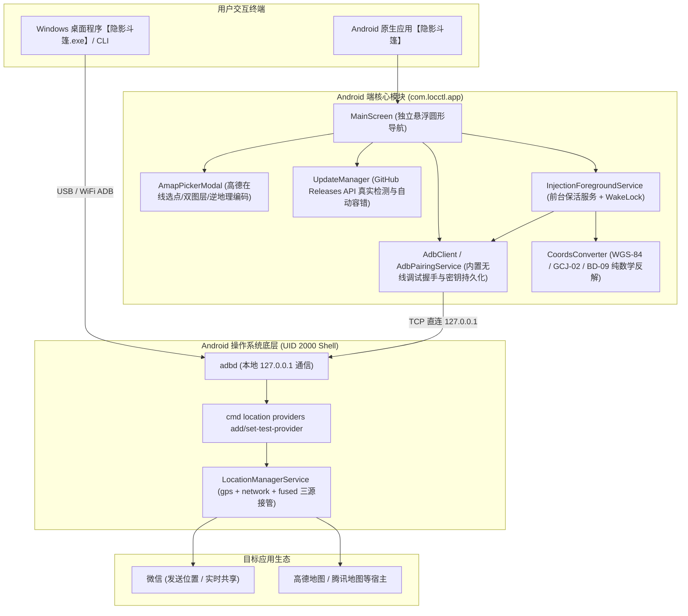

# AGENTS.md — 隐影斗篷 (LocCloak) Agent 协同与项目全景指南

> 本文件是 AI Agent（包括 Antigravity、Gemini、CodeBuddy、Claude 等）在协助开发维护 `LocCloak (隐影斗篷)` 项目时的**核心行为准则、架构索引与工程上下文权威指南**。所有 Agent 在执行代码修改、编译交付与交互响应时**必须无条件严格遵守**。

---

## 1. 核心铁律与行为红线 (Critical Guardrails)

> [!CAUTION]
> **以下为本项目的最高优先级铁律，任何 Agent 不得擅自绕过或违反：**

### 1.1 严禁 Agent 自行进行 UI/功能模拟测试（必须人工真机测试）
- **核心禁令**：Agent **严禁**使用 `adb screencap` 截屏、`uiautomator dump` 提取界面层次、`input tap` 模拟点击、录屏或任何自动化脚本自行验证 APP 功能。
- **违规后果**：自动化截屏与 dump 会生成大量体积庞大的垃圾文件（如 `.png`、`.xml`、数十兆的 `logcat.txt`），严重污染工作区与 Git 仓库；同时会强行侵入手机前台打断用户正常操作。
- **标准交付动作**：
  1. 完成代码修改；
  2. 执行编译构建（Release APK）；
  3. 仅通过 ADB 安装并拉起应用（`adb install -r -d` 与 `am start`）；
  4. **立即停止多余工具调用，直接向用户汇报并交付，由用户在实体手机上进行人工手动体验与测试验证**。

### 1.2 命令行与工具调用规范（ripgrep `rg` 显式目标路径）
- 在非交互式管道（如 `run_command` 等工具调用子进程）中执行 `rg` 时，**必须显式提供搜索目标路径参数**（例如 `rg "<pattern>" .` 或 `rg "<pattern>" <指定目录>`），**严禁省略目标路径**导致子进程等待 stdin EOF 而超时挂起。

### 1.3 真实软件更新机制规范（严禁静态 Mock）
- 绝不允许使用 `delay(600)` 等静态延时弹窗伪造更新检查。
- 所有更新逻辑必须通过 `UpdateManager.checkForUpdates` 发起真实的 GitHub Releases API 请求，并使用分段语义化比对算法。

### 1.4 版本号与发布资产强一致性
- `APP/app/build.gradle.kts` 的 `versionName` 必须与 GitHub Release Tag (SemVer) 严格一致（如 `v2.1.0` 对应 `versionName = "2.1.0"`）。
- 每次发布 Release 必须打包并上传标准命名的安装包资产：`LocCloak-vX.Y.Z-android-universal.apk`。

### 1.5 现代化 UI 与悬浮圆形按钮规范
- 底部 Tab 导航栏必须保持**悬浮在页面底部的独立圆形按钮（CircleShape）**，彼此之间由空白完全隔开，严禁回退为通栏实心底座。
- 图标统一使用 `compose.icons.FeatherIcons` 矢量图标库。

---

## 2. 项目本质与双交付形态

`隐影斗篷 (LocCloak)` 专为 Android 设计的高性能、免选模拟应用、防应用嗅探的**软硬件级虚拟定位控制系统**：

1. **Android 原生独立客户端 (`APP/`)**：
   - 纯 Kotlin + Jetpack Compose 现代化原生实现；
   - 应用显示名称：**隐影斗篷**，包名：`com.locctl.app`；
   - 内置无线 ADB 协议栈，**手机脱离电脑完全独立运行**；
   - 开发者选项「选择模拟位置信息应用」**完全保持为空（无）**，系统底层由 UID 2000 (Shell) 接管，目标应用无法嗅探检测；
   - 集成高德地图在线交互选点、冷启动后台静默更新检测、高频常驻保活服务。
2. **桌面 CLI / GUI 客户端 (`bin/` + `src/`)**：
   - 基于 Node.js（零 npm 外部依赖，内置 Windows 官方 ADB）；
   - 提供双击秒开的 **`隐影斗篷.exe`** (`LocCloak.exe`) 与单文件便携独立版。

---

## 3. 总体架构设计



---

## 4. 关键技术实现与模块索引

### 4.1 Android 端核心目录结构
```text
APP/app/src/main/
├── java/com/locctl/app/
│   ├── adb/                        # 无线 ADB 协议栈 (TLS SPAKE2 配对、mDNS 探测、AdbClient)
│   │   ├── AdbClient.kt            # TCP 直连 127.0.0.1 封包解包与命令执行
│   │   ├── AdbPairingService.kt    # 通知栏 RemoteInput 截码服务
│   │   ├── AdbKey.kt               # 本地自签公私钥生成与持久化
│   │   └── AdbMdns.kt              # mDNS 自动嗅探调试端口
│   ├── core/                       # 核心业务算法与数据层
│   │   ├── CoordsConverter.kt      # GCJ-02 / WGS-84 / BD-09 高阶迭代反解 (误差<1e-9度)
│   │   ├── LocationInjector.kt     # cmd location 底层注入封装
│   │   └── SavedLocationManager.kt # 常用地址与预设库本地持久化
│   ├── service/                    # 后台前台保活服务
│   │   ├── InjectionForegroundService.kt # 500ms 高频常驻注入循环 + WakeLock 保活
│   │   └── BootReceiver.kt         # 开机与应用替换广播监听
│   ├── update/                     # 真实在线更新系统
│   │   └── UpdateManager.kt        # GitHub Releases API 请求、语义化数组比对、容错回退
│   └── ui/                         # Jetpack Compose UI
│       ├── MainScreen.kt           # 主容器、冷启动 1.5s 后台静默更新检测、悬浮圆形导航
│       └── screens/
│           ├── LocationScreen.kt   # 目标位置设置、高德选点入口、常用地址、注入控制
│           ├── AmapPickerModal.kt  # 高德官方切片选点、矢量/卫星双图层、逆地理编码、城市跳转
│           ├── AdbScreen.kt        # 无线调试状态看板与配对指引
│           ├── LogsScreen.kt       # 实时调试控制台
│           └── AboutScreen.kt      # 关于应用、开发者联系方式、手动检查更新
├── assets/                         # 离线 Leaflet 引擎与 amap_picker.html
├── AndroidManifest.xml             # 权限配置 (网络、前台服务、自启动)
└── proguard-rules.pro              # R8 混淆规则 (保留 WebBridge @JavascriptInterface)
```

### 4.2 桌面端核心文件索引
```text
/
├── 隐影斗篷.exe                     # 根目录双击直接启动的 Windows 桌面客户端
├── LocCloak.exe                    # 别名执行程序
├── bin/
│   ├── loccloak.js                 # 桌面 CLI 启动入口
│   └── platform-tools/             # 内置 Windows 官方免安装 ADB 套件
├── src/
│   ├── cli.js                      # 命令行 13 个子命令分发
│   ├── adb.js                      # 常驻 adb shell 进程池 (单次执行 ~5ms)
│   ├── mock.js                     # 注入核心逻辑
│   └── web/                        # Web / 桌面 UI 前端界面静态资源
├── scripts/
│   ├── build-exe.js                # 桌面 EXE 自动化编译脚本
│   └── launcher.cs                 # C# 独立托盘宿主启动器源码
└── package.json                    # NPM 配置与别名映射
```

---

## 5. 常用研发与构建指令

### 5.1 Android 端构建与真机部署
```powershell
# 1. 切换至 JDK 17 环境
$env:JAVA_HOME = "C:\Program Files\Java\jdk-17"

# 2. 编译 Release APK
cd d:\VS\孙天奇\WX定位\APP
.\gradlew.bat assembleRelease --console=plain

# 3. 安装至实体手机并启动
adb -s b615477b install -r -d app/build/outputs/apk/release/app-release.apk
adb -s b615477b shell am start -n com.locctl.app/.MainActivity
```

### 5.2 桌面端编译与运行
```powershell
# 运行命令行自检
node bin/loccloak.js doctor

# 启动 Web UI 调试控制台
node bin/loccloak.js ui

# 重新编译 Windows 桌面可执行程序 (.exe)
node scripts/build-exe.js
```

---

## 6. 微信定位人工测试关键步骤 (Critical Testing Steps)

当 Agent 完成代码修改并部署到实体手机后，用户按以下步骤进行真机人工验证：
1. **划掉彻底杀死微信后台**，重新打开微信进入【发送位置】页面；
2. **在地图界面停留 5~8 秒**，让腾讯地图底层完成底图瓦片与定位点的加载刷新；
3. 验证地图中心大头针是否已吸附在设定的目标经纬度位置。

---

## 7. 开发者与联系方式

- **微信 (WeChat)**：`pOVOq-521`
- **QQ**：`2697905019`
- **GitHub 开源仓库**：[https://github.com/gitstq/LocCloak](https://github.com/gitstq/LocCloak)
