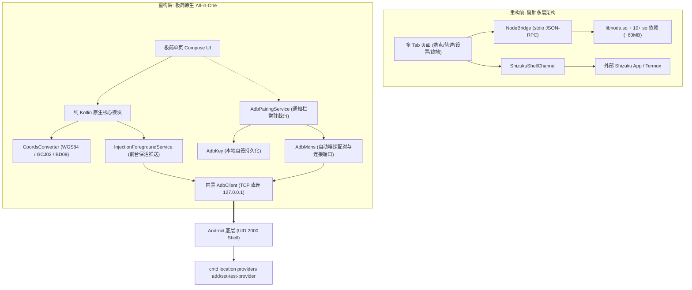

# WX定位 APP 极简一体化重构方案（All-in-One 单页架构）

> **目标**：将 `D:\VS\孙天奇\WX定位\APP` 重构为一个零外部依赖、极轻量（~3MB）、拥有 Shizuku 同款通知栏无线配对能力、且在系统开发者选项中**彻底免选模拟位置应用**的独立单页 Android 应用。

---

## 一、 背景与重构痛点

### 1. 现有架构痛点
1. **外部依赖繁琐**：原本依赖手机预装独立 Shizuku App，曾考虑过 Termux，用户链路长且易产生权限割裂。
2. **配对体验缺陷**：过去误认为无 Root 必须两台设备无线调试；而 Android 11+ 若跳出配对弹窗，配对码会立即失效。
3. **体积严重臃肿**：引入了整个 Node.js 运行时（`libnode.so` 及 10 几个 native 依赖库、assets/js 脚本），APK 超过 60MB，冷启动耗时增加 300ms 且存在 stdio 进程管道崩溃隐患。
4. **界面过重**：包含地图选点、GPX 轨迹回放、终端日志、复杂配置等多个 Tab，偏离了核心的单点注入场景。

### 2. 重构设计原则
* **真正的单 APK 闭环**：手机无需安装 Shizuku、Termux 或额外工具。
* **Shizuku 同款通知栏配对**：用户停留在系统无线调试页时，下拉通知栏直接输入 6 位验证码，一次配对、本地持久化密钥、后续免配对直连。
* **系统设置零侵入**：底层直接由本地 ADB 连接（UID 2000）向系统 `cmd location` 注入，**Android 开发者选项里的「选择模拟位置信息应用」始终保持为空（无）**，避免被目标应用扫描检测。
* **全原生 Kotlin**：彻底裁撤 Node.js 全家桶，坐标系换算纯数学原生实现，APK 降至约 3MB。
* **极简单页 UI**：界面仅保留核心三要素：配对状态、经纬度输入与坐标系切换、注入启停。

---

## 二、 总体架构设计（Before vs After）



---

## 三、 文件增删与模块裁撤清单

### 1. 彻底删除的冗余文件
```text
[删除] app/src/main/assets/node/           # 删除全部 so 库 (libc++, libcrypto, libsqlite3 等)
[删除] app/src/main/assets/js/             # 删除 bridge.js, gpx.js 等 JS 脚本
[删除] app/src/main/jniLibs/               # 删除 libnode.so
[删除] app/src/main/java/com/locctl/app/node/       # 删除 NodeBridge.kt, NodeRuntime.kt
[删除] app/src/main/java/com/locctl/app/shizuku/    # 删除旧的依赖外部 Shizuku 的通道
[删除] app/src/main/java/com/locctl/app/ui/route/   # 删除轨迹回放相关界面
[删除] app/src/main/java/com/locctl/app/ui/terminal/# 删除终端回显界面
[删除] app/src/main/java/com/locctl/app/ui/setup/   # 删除旧的繁琐设置流
```

### 2. 新增与移植文件
```text
app/src/main/java/com/locctl/app/
├── adb/                        <-- 从本地 Shizuku 源码 manager 模块直接移植
│   ├── AdbClient.kt            # ADB 通信、握手与 Shell Stream 执行
│   ├── AdbException.kt         # 异常封装
│   ├── AdbKey.kt               # RSA/TLS 自签密钥生成与文件持久化
│   ├── AdbMdns.kt              # mDNS 自动嗅探无线调试配对/通信端口
│   ├── AdbMessage.kt           # ADB 协议封包/解包
│   ├── AdbPairingClient.kt     # TLS SPAKE2 握手客户端
│   ├── AdbPairingService.kt    # 前台通知栏截获 6 位验证码服务
│   └── AdbProtocol.kt          # ADB 命令协议常量
├── core/
│   ├── CoordsConverter.kt      # 纯 Kotlin 坐标转换 (WGS-84 / GCJ-02 / BD-09)
│   └── LocationInjector.kt     # 基于 AdbClient 的 appops 和 cmd location 注入器
├── service/
│   └── InjectionForegroundService.kt  # 简化的前台推送保活服务
└── ui/
    ├── MainActivity.kt         # 宿主 Activity
    └── MainSingleScreen.kt     # 唯一的 Compose 单页界面
```

---

## 四、 核心技术实现规范

### 1. Shizuku 无线 ADB 协议栈移植规范
直接复用 `d:\VS\孙天奇\Shizuku\Shizuku\manager\src\main\java\moe\shizuku\manager\adb\` 中的实现，包名适配到 `com.locctl.app.adb`：
1. **配对拦截交互（`AdbPairingService`）**：
   * 在用户点击【开始配对】时触发前台通知，通知附带 `RemoteInput`（标题为“输入 6 位配对码”）。
   * 用户留在系统设置「无线调试」弹窗，下拉通知栏即可输入验证码。
   * 服务收到验证码后，结合 `AdbMdns` 侦测到的配对端口（或备用手动端口），调用 `AdbPairingClient.start(ip, port, code)` 完成 TLS 握手。
2. **密钥持久化（`AdbKey`）**：
   * 将公私钥存储于 `context.filesDir.resolve("adb_keys")`。
   * 只要用户不关闭系统“无线调试”，下次打开 App 即可直接通过 `AdbClient` 握手通信，无需重复配对。
3. **命令执行（`AdbClient`）**：
   * 通过本地 Socket 直连 `127.0.0.1:<connect_port>`，打开 `shell:` 流，直接执行 ADB 调试指令。

---

### 2. 纯 Kotlin 坐标转换实现（`CoordsConverter.kt`）
完全还原 `src/coords.js` 的数学精度（高德/腾讯/微信 GCJ-02 ↔ GPS 原始 WGS-84 迭代反解）：

```kotlin
package com.locctl.app.core

import kotlin.math.*

object CoordsConverter {
    private const val PI = Math.PI
    private const val A = 6378245.0
    private const val EE = 0.00669342162296594323
    private const val X_PI = PI * 3000.0 / 180.0

    fun outOfChina(lat: Double, lng: Double): Boolean {
        return !(lng in 73.66..135.05 && lat in 3.86..53.55)
    }

    private fun transformLat(x: Double, y: Double): Double {
        var ret = -100.0 + 2.0 * x + 3.0 * y + 0.2 * y * y + 0.1 * x * y + 0.2 * sqrt(abs(x))
        ret += (20.0 * sin(6.0 * x * PI) + 20.0 * sin(2.0 * x * PI)) * 2.0 / 3.0
        ret += (20.0 * sin(y * PI) + 40.0 * sin(y / 3.0 * PI)) * 2.0 / 3.0
        ret += (160.0 * sin(y / 12.0 * PI) + 320.0 * sin(y * PI / 30.0)) * 2.0 / 3.0
        return ret
    }

    private fun transformLng(x: Double, y: Double): Double {
        var ret = 300.0 + x + 2.0 * y + 0.1 * x * x + 0.1 * x * y + 0.1 * sqrt(abs(x))
        ret += (20.0 * sin(6.0 * x * PI) + 20.0 * sin(2.0 * x * PI)) * 2.0 / 3.0
        ret += (20.0 * sin(x * PI) + 40.0 * sin(x / 3.0 * PI)) * 2.0 / 3.0
        ret += (150.0 * sin(x / 12.0 * PI) + 300.0 * sin(x / 30.0 * PI)) * 2.0 / 3.0
        return ret
    }

    fun wgs84ToGcj02(lat: Double, lng: Double): Pair<Double, Double> {
        if (outOfChina(lat, lng)) return lat to lng
        var dLat = transformLat(lng - 105.0, lat - 35.0)
        var dLng = transformLng(lng - 105.0, lat - 35.0)
        val radLat = lat / 180.0 * PI
        var magic = sin(radLat)
        magic = 1 - EE * magic * magic
        val sqrtMagic = sqrt(magic)
        dLat = (dLat * 180.0) / ((A * (1 - EE)) / (magic * sqrtMagic) * PI)
        dLng = (dLng * 180.0) / (A / sqrtMagic * cos(radLat) * PI)
        return (lat + dLat) to (lng + dLng)
    }

    // 迭代反解，误差 < 1e-9 度（与 Node 版完全一致）
    fun gcj02ToWgs84(lat: Double, lng: Double): Pair<Double, Double> {
        if (outOfChina(lat, lng)) return lat to lng
        var mLat = lat
        var mLng = lng
        for (i in 0 until 12) {
            val (fLat, fLng) = wgs84ToGcj02(mLat, mLng)
            val dLat = fLat - lat
            val dLng = fLng - lng
            mLat -= dLat
            mLng -= dLng
            if (abs(dLat) < 1e-9 && abs(dLng) < 1e-9) break
        }
        return mLat to mLng
    }

    fun bd09ToGcj02(lat: Double, lng: Double): Pair<Double, Double> {
        val x = lng - 0.0065
        val y = lat - 0.006
        val z = sqrt(x * x + y * y) - 0.00002 * sin(y * X_PI)
        val theta = atan2(y, x) - 0.000003 * cos(x * X_PI)
        return (z * sin(theta)) to (z * cos(theta))
    }

    // 统一入口：目标输出一律为底层的 WGS-84
    fun toWgs84(lat: Double, lng: Double, sourceSystem: String): Pair<Double, Double> {
        return when (sourceSystem.lowercase()) {
            "gcj02" -> gcj02ToWgs84(lat, lng)
            "bd09" -> {
                val (gLat, gLng) = bd09ToGcj02(lat, lng)
                gcj02ToWgs84(gLat, gLng)
            }
            else -> lat to lng
        }
    }
}
```

---

### 3. 底层免勾选注入引擎（`LocationInjector.kt`）

```kotlin
package com.locctl.app.core

import com.locctl.app.adb.AdbClient
import kotlinx.coroutines.Dispatchers
import kotlinx.coroutines.withContext

class LocationInjector(private val adb: AdbClient) {

    private val providers = listOf("gps", "network", "fused")

    /**
     * 免选模拟位置应用的核心：
     * 直接给 com.android.shell 赋予 android:mock_location
     */
    suspend fun setupPermissions() = withContext(Dispatchers.IO) {
        adb.executeCommand("appops set com.android.shell android:mock_location allow")
    }

    /**
     * 接管系统的 gps、network、fused 三源
     */
    suspend fun installProviders() = withContext(Dispatchers.IO) {
        for (p in providers) {
            adb.executeCommand("cmd location providers remove-test-provider $p")
            val flags = when (p) {
                "gps" -> "--requiresSatellite --supportsAltitude --supportsSpeed --supportsBearing --powerRequirement 3"
                "network" -> "--requiresNetwork --requiresCell --supportsAltitude --supportsSpeed --supportsBearing"
                else -> ""
            }
            adb.executeCommand("cmd location providers add-test-provider $p $flags")
            adb.executeCommand("cmd location providers set-test-provider-enabled $p true")
        }
    }

    /**
     * 实时推送坐标（刷新时间戳，规避微信 elapsedRealtime 过期丢弃）
     */
    suspend fun pushLocation(wgsLat: Double, wgsLng: Double, accuracy: Float = 3f) = withContext(Dispatchers.IO) {
        val now = System.currentTimeMillis()
        val loc = "--location $wgsLat,$wgsLng --accuracy $accuracy --time $now"
        for (p in providers) {
            adb.executeCommand("cmd location providers set-test-provider-location $p $loc")
        }
    }

    /**
     * 恢复真实定位
     */
    suspend fun restore() = withContext(Dispatchers.IO) {
        for (p in providers) {
            adb.executeCommand("cmd location providers remove-test-provider $p")
        }
    }
}
```

---

### 4. 极简单页 Compose UI 规格（`MainSingleScreen.kt`）

布局分为三个自上而下的卡片模块：

```text
┌──────────────────────────────────────────────┐
│  [卡片 1] 无线 ADB 状态与配对                │
│  ● 状态: 未连接 / 已连接 (绿灯)             │
│  [ 发送配对通知 ] (引导用户去无线调试页配对) │
└──────────────────────────────────────────────┘
┌──────────────────────────────────────────────┐
│  [卡片 2] 目标位置输入                       │
│  纬度: [ 30.274602               ]          │
│  经度: [ 120.211963              ]          │
│  坐标系: (●) GCJ-02 (微信/高德)  ( ) WGS-84 │
│  精度: 3m   刷新间隔: 500ms                  │
└──────────────────────────────────────────────┘
┌──────────────────────────────────────────────┐
│  [卡片 3] 控制开关                           │
│  [   ▶ 开始常驻注入 (保持有效)   ]            │
│  [   ■ 停止注入并恢复真实定位    ]            │
└──────────────────────────────────────────────┘
```

---

## 五、 四阶段实施计划

### 阶段 1：工程清理与纯原生瘦身
* 清理 `app/src/main/assets/node/`、`app/src/main/jniLibs/` 及多余 JS 文件。
* 移除 `NodeBridge.kt` 与 `NodeRuntime.kt`。
* 引入纯 Kotlin 编写的 `CoordsConverter.kt`，验证坐标系互转单元测试。

### 阶段 2：移植 Shizuku 无线 ADB 协议栈
* 拷贝 `AdbPairingService`、`AdbPairingClient`、`AdbMdns`、`AdbClient`、`AdbKey` 到 `com.locctl.app.adb`。
* 在 `AndroidManifest.xml` 中声明 `AdbPairingService` 及必要的通知权限。
* 实机测试：在无线调试页下拉通知栏输入配对码，验证本地密钥生成与连接成功。

### 阶段 3：注入器与保活服务改造
* 编写 `LocationInjector.kt`，接入 `AdbClient`。
* 重构 `InjectionForegroundService`，剥离多余的 GPX 轨迹回放逻辑，专注于定时循环调用 `LocationInjector.pushLocation` 刷新时间戳。

### 阶段 4：极简单页 UI 搭建与端到端验证
* 编写 `MainSingleScreen.kt`，替换原先复杂的导航组件。
* 端到端验证：
  1. 手机开发者选项中「选择模拟位置信息应用」保持为“无”。
  2. 启动保持注入后，打开高德/微信等应用，确认定位成功固定在目标地点且不漂移。
  3. 点击停止后，确认测试源成功移除、真实定位恢复。

