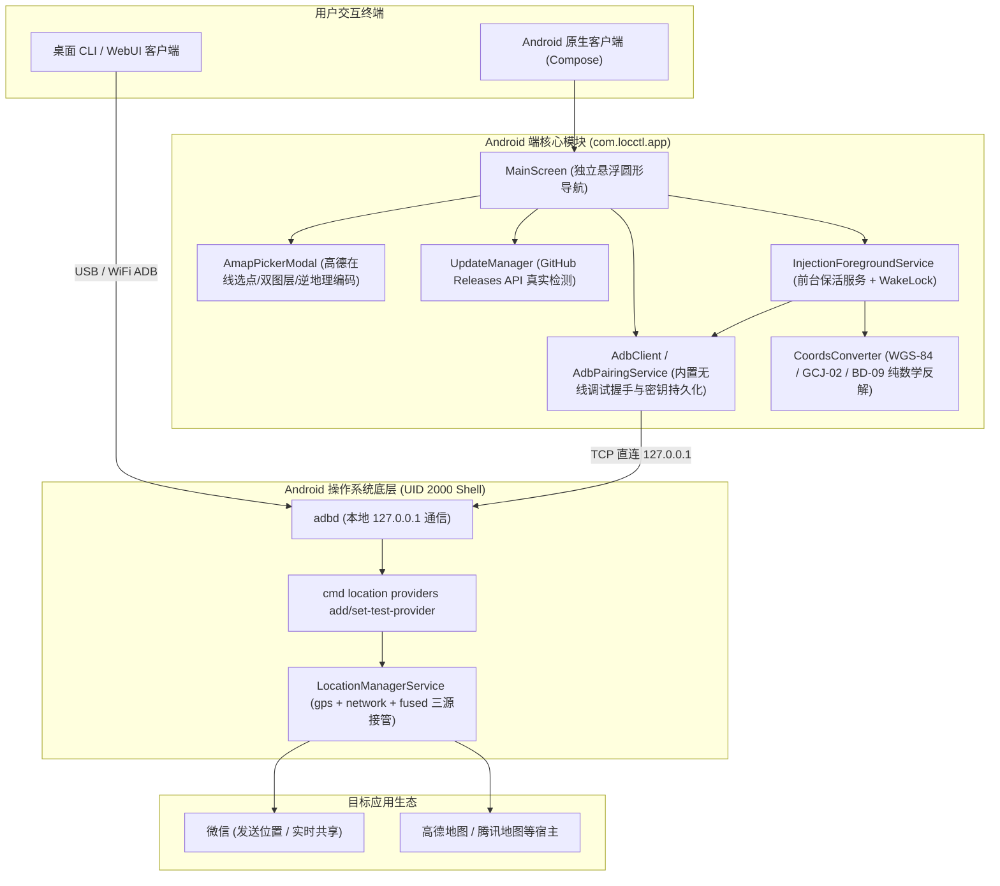

# locctl 项目初始化与全景研发文档 (Project Init & Architecture Guide)

> **版本**：v2.1.0  
> **仓库**：[https://github.com/gitstq/locctl](https://github.com/gitstq/locctl)  
> **作者/开发者**：微信：`pOVOq-521` ｜ QQ：`2697905019` ｜ GitHub：[@gitstq](https://github.com/gitstq)

---

## 1. 项目概述与愿景

`locctl` 是一套专为 Android 设计的高性能、免选模拟应用、防应用嗅探的**软硬件级虚拟定位控制系统**。
项目针对主流社交应用（微信、企业微信等）在特定场景下的高频定位需求，提供全闭环、低延迟、零系统侵入的定位接管方案。

### 1.1 核心交付形态
项目采用**一套能力、双端闭环**的工程架构：
1. **Android 原生移动端应用 (`APP/`)**：
   - 纯 Kotlin + Jetpack Compose 现代化原生实现；
   - 内置完整无线 ADB 协议栈，**手机脱离电脑完全独立运行**；
   - 开发者选项「选择模拟位置信息应用」**完全保持为空（无）**，系统底层由 UID 2000 (Shell) 接管，目标应用无法嗅探检测；
   - 集成高德地图在线选点、冷启动后台静默更新检测、高频常驻保活服务。
2. **桌面 CLI / GUI 客户端 (`bin/` + `src/`)**：
   - 基于 Node.js（零 npm 外部依赖，内置 Windows 官方 ADB）；
   - 提供独立便携 EXE 桌面窗口与高性能命令行工具。

---

## 2. 总体架构设计



---

## 3. 核心功能与关键技术实现

### 3.1 内置无线 ADB 与免选模拟应用（防嗅探核心）
- **问题背景**：传统模拟定位必须在开发者选项中勾选“选择模拟位置信息应用”，任何第三方 App 均可通过 `Location.isFromMockProvider()` 或系统 API 轻松嗅探检测，导致风控封号。
- **locctl 方案**：
  1. 通过移植 Shizuku 同款无线 ADB 协议栈，直接以 `UID 2000 (shell)` 身份向系统底层执行：
     ```bash
     cmd location providers add-test-provider gps
     cmd location providers set-test-provider-enabled gps true
     cmd location providers set-test-provider-location gps <lat> <lng> ...
     ```
  2. **系统设置中「模拟位置信息应用」始终为空**，彻底粉碎目标应用的 Mock 嗅探机制。
  3. 支持通知栏常驻抓取 6 位配对码，单次配对后本地自签公私钥持久化，后续冷启动免配对直接连接。

### 3.2 坐标系高精度无损互转（纯 Kotlin 原生）
- 微信底图与高德地图在中国大陆采用国测局 **GCJ-02** 加偏坐标；
- Android 系统底层 `LocationManager` 驱动只接收国际标准 **WGS-84** 坐标；
- 本项目在 [`CoordsConverter.kt`](file:///d:/VS/孙天奇/WX定位/APP/app/src/main/java/com/locctl/app/core/CoordsConverter.kt) 中实现高阶迭代反解算法（12 次二分逼近），将 GCJ-02/BD-09 反解为 WGS-84，运算误差小于 `1e-9` 度（厘米级精度）。

### 3.3 高德地图在线交互选点组件
- **底层引擎**：内置 Leaflet 离线框架于 `assets/`，零网络加载延迟；
- **官方切片源**：接入高德官方在线瓦片（`webrd0{s}.is.autonavi.com`），原生对齐 GCJ-02 坐标系；
- **核心能力**：
  - 支持「高德标准矢量底图」与「高德卫星实景影像+注记路网」双图层平滑切换；
  - 屏幕正中心固定动效瞄准图钉（拖动浮起、静止吸附），实时捕捉坐标；
  - 支持地名/道路搜索与直输经纬度检索定位；
  - 内置全国热门城市（北京、上海、广州、深圳、杭州、成都等）一键飞行动画跳转；
  - 400ms 防抖自动逆地理编码，显示街道门牌中文地址；
  - 一键将选定点经纬度回填至主界面，并自动设定坐标系为 GCJ-02。

### 3.4 真实软件更新与后台静默检测机制
- **真实联网比对**：向 GitHub Releases API (`GET /repos/gitstq/locctl/releases/latest`) 请求最新元数据，绝不允许延时假冒；
- **分段语义化比对**：采用 `Major.Minor.Patch` 数字数组逐位比对，杜绝字符串字典序错误；
- **后台静默策略**：APP 冷启动 1.5 秒后在后台异步静默检查，若已是最新版或网络异常保持 100% 零干扰；若发现新版，弹窗展示版本差、更新日志，提供「稍后再说」与「立即更新」。

---

## 4. 项目研发铁律与发版规范 (Project Rules)

> 以下规则已同步固化至 [`.gemini/rules/project_rules.md`](file:///d:/VS/孙天奇/WX定位/.gemini/rules/project_rules.md) 与 [`PROJECT_RULES.md`](file:///d:/VS/孙天奇/WX定位/PROJECT_RULES.md)，所有开发者与 AI 助手**必须严格遵守**。

| 序号 | 规则名称 | 核心要求 |
|---|---|---|
| **1** | **禁止 AI 自行验证** | **严禁 AI 使用 `adb screencap`、`dump`、模拟点击自行验证**。每次构建安装后直接交付，由人工在真机上体验测试，防止垃圾文件污染与手机前台干扰。 |
| **2** | **真实在线更新** | 必须由 `UpdateManager.checkForUpdates` 发起真实 GitHub Releases API 请求，禁止任何 mock/delay 假逻辑。 |
| **3** | **语义化版本对齐** | `build.gradle.kts` 的 `versionName` 必须与 GitHub Release Tag (SemVer) 严格一致；`versionCode` 单调递增；禁止界面硬编码版本号。 |
| **4** | **Release 资产命名规范** | 每次 GitHub 发版必须打包并上传 `Locctl-vX.Y.Z-android-universal.apk` 标准安装包资产。 |
| **5** | **UI 悬浮独立圆形按钮** | 底部导航必须保持**悬浮在页面底部的独立圆形按钮（CircleShape）**，中间由空白完全隔开；列表底部必须预留至少 `100.dp` 避让边距。 |
| **6** | **图标库规范** | 统一采用 `compose.icons.FeatherIcons` 矢量图标库。 |
| **7** | **命令行与工具调用** | 在非交互管道（如 `run_command`）中执行 `rg` 时，**必须显式提供目标路径**（如 `rg "<pattern>" .`），严禁阻塞挂起。 |

---

## 5. 软件测试关键步骤 (Critical Testing Steps)

为确保模拟定位在微信等目标应用中 100% 生效，人工测试时**必须严格遵守以下关键步骤**：
1. **划掉杀死微信后台**，重新打开微信进入【发送位置】页面；
2. **在地图界面停留 5~8 秒**，让腾讯地图底层完成底图瓦片与真实 GPS 定位点的加载刷新；
3. 确认地图中心大头针已精准吸附至所设置的经纬度目标点。

---

## 6. 构建、打包与发布指令

### 6.1 Android 原生端编译
```powershell
# 切换至 JDK 17 环境
$env:JAVA_HOME = "C:\Program Files\Java\jdk-17"

# 进入 APP 目录
cd d:\VS\孙天奇\WX定位\APP

# 编译 Release APK
.\gradlew.bat assembleRelease --console=plain

# 安装到连接的真机设备
adb -s b615477b install -r -d app/build/outputs/apk/release/app-release.apk

# 启动主界面
adb -s b615477b shell am start -n com.locctl.app/.MainActivity
```

### 6.2 桌面端运行与打包
```powershell
# 运行命令行自检
node bin/locctl.js doctor

# 启动 Web / 桌面 UI 界面
node bin/locctl.js ui

# 打包便携单文件 EXE
npm run dist:win
```

---

## 7. 目录全景索引

```text
d:\VS\孙天奇\WX定位/
├── INIT.md                        # 本文档（项目全景初始化与研发指南）
├── PROJECT_RULES.md               # 项目开发、发版与测试红线规范
├── README.md                      # 仓库对外展示主页
├── CODEBUDDY.md                   # CodeBuddy Agent 上下文指引
├── .gemini/rules/project_rules.md # Gemini / Antigravity Agent 全局生效规则
├── .codebuddy/rules.md            # CodeBuddy 规范镜像
├── APP/                           # Android 原生客户端主工程 (Kotlin + Compose)
│   ├── app/
│   │   ├── src/main/
│   │   │   ├── java/com/locctl/app/
│   │   │   │   ├── adb/           # 无线 ADB 客户端、配对与证书管理
│   │   │   │   ├── core/          # 坐标换算、常用地址、注入通道
│   │   │   │   ├── service/       # 前台常驻保活服务、开机广播
│   │   │   │   ├── update/        # GitHub Releases 真实版本检测
│   │   │   │   └── ui/            # Compose UI 界面与主题
│   │   │   │       ├── screens/   # LocationScreen, AdbScreen, LogsScreen, AboutScreen, AmapPickerModal
│   │   │   │       └── MainScreen.kt
│   │   │   ├── assets/            # Leaflet 地图引擎与 amap_picker.html
│   │   │   └── AndroidManifest.xml
│   │   ├── build.gradle.kts       # 模块编译配置 (versionName, dependencies)
│   │   └── proguard-rules.pro     # R8 混淆保护规则 (保留 WebBridge 接口)
│   └── gradlew.bat
├── bin/                           # 桌面 CLI 启动入口与内置 platform-tools (ADB)
├── src/                           # 桌面 CLI 核心源码与 Web UI 前端静态资源
└── routes/                        # 示例 GPX 路径轨迹文件
```

---

## 8. 作者与支持

- **开发者微信**：`pOVOq-521`
- **开发者 QQ**：`2697905019`
- **GitHub 开源项目**：[https://github.com/gitstq/locctl](https://github.com/gitstq/locctl)
- **问题反馈与建议**：欢迎在 GitHub Issues 提交反馈。
